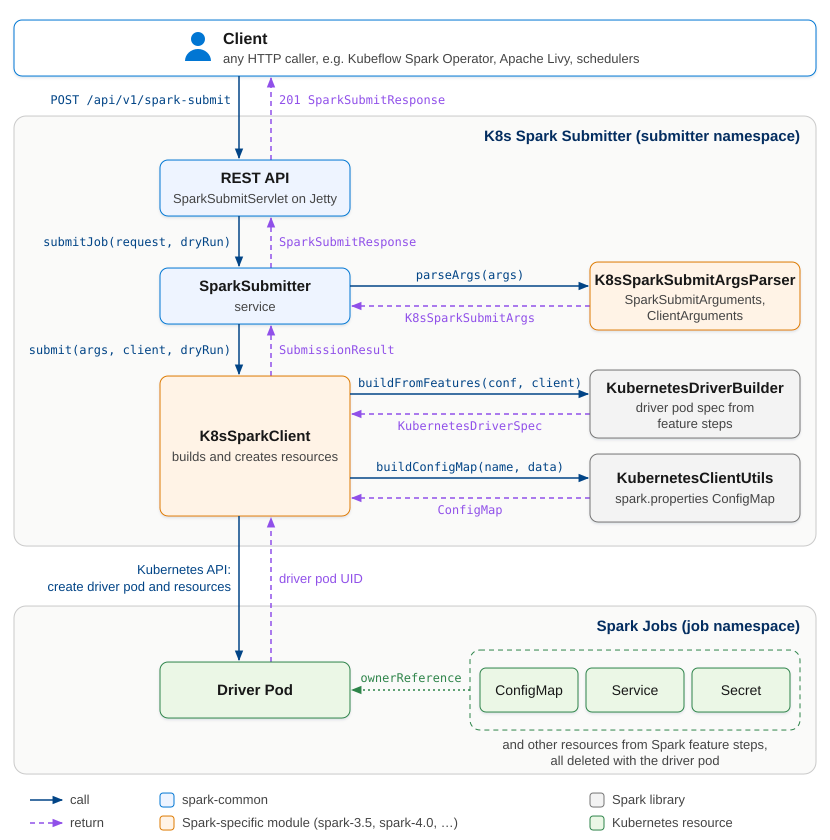

# Kubernetes Spark Submitter

[](https://github.com/venkomirisetti/k8s-spark-submitter/actions/workflows/pr-validate.yml)
[](https://github.com/venkomirisetti/k8s-spark-submitter/actions/workflows/build-and-push.yml)
[](https://codecov.io/gh/venkomirisetti/k8s-spark-submitter)

A stateless, **fire-and-forget** REST service that submits Spark jobs to Kubernetes. Instead of running the
`spark-submit` CLI, which spins up two JVMs for every job inside the client's pod, it creates the driver pod
directly through the Kubernetes API using Spark's own libraries. Clients send one REST call and keep their
CPU and memory free.



## Why

Tools such as the [Kubeflow Spark Operator](https://github.com/kubeflow/spark-operator) run `spark-submit`
for every application, so those JVMs compete for the operator pod's limited resources and a burst of
submissions drives latency up. Moving submission into this service keeps the caller light, and the
submitter scales horizontally to absorb bursts.

To use it with the Spark Operator, see their
[REST submitter guide](https://github.com/kubeflow/spark-operator/blob/master/docs/website/user-guide/rest-submitter.md).

## Features

- **Spark-compatible:** accepts standard `spark-submit` arguments
- **Cluster mode only:** client mode is rejected with a validation error
- **Job tracking left to Kubernetes:** the response returns the driver pod name to watch
- **Self-cleaning:** every resource is owned by the driver pod and deleted with it
- **Secure:** optional HTTPS and mTLS with automatic certificate reload
- **Observable:** health and Prometheus metrics on a separate probe port

## Supported Spark versions

| Spark | Image tags | Base image |
| --- | --- | --- |
| 4.0 | `<spark-version>-<build\|latest>`<br>`4.0-<build\|latest>` | `docker.io/library/spark:4.0.1` |
| 3.5 | `<spark-version>-<build\|latest>`<br>`3.5-<build\|latest>` | `docker.io/library/spark:3.5.9-java17` |

`<spark-version>` is the Spark version of the base image. Images are published to
`venkomirisetti/k8s-spark-submitter`, for example:

```text
venkomirisetti/k8s-spark-submitter:4.0.1-20
venkomirisetti/k8s-spark-submitter:4.0.1-latest
venkomirisetti/k8s-spark-submitter:4.0-20
venkomirisetti/k8s-spark-submitter:4.0-latest
```

## Quick start

```bash
helm install spark-submitter charts/spark-submitter/ \
  --namespace spark-submitter --create-namespace
```

Then submit a job with `POST /api/v1/spark-submit`. The [User Guide](docs/user-guide.md#getting-started)
walks through a complete SparkPi run, and the [chart README](charts/spark-submitter/README.md) covers
values, TLS and RBAC.

## Documentation

- [User Guide](docs/user-guide.md): getting started, API, configuration, TLS
- [Development](docs/development.md): architecture, building, Spark version modules, Docker, CI/CD

## License

Licensed under the [Apache License, Version 2.0](LICENSE). See [NOTICE](NOTICE).

## Credits

Created by **Venkateswarlu Komirisetti**. Built under the Salesforce Spark product, sponsored by
[Salesforce](https://www.salesforce.com).
