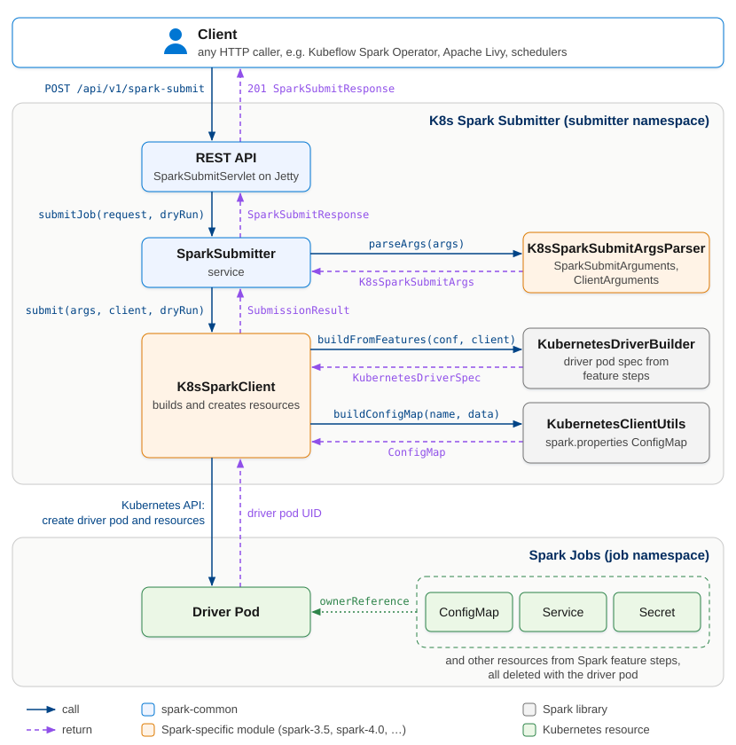

# Development

## Architecture

### Components



### Spark Libraries Used

The service uses Spark's internal (package-private) classes:

| Class | Package | Purpose |
|-------|---------|---------|
| `SparkSubmitArguments` | `org.apache.spark.deploy` | Parse CLI args |
| `SparkSubmit.prepareSubmitEnvironment` | `org.apache.spark.deploy` | Build SparkConf |
| `ClientArguments` | `org.apache.spark.deploy.k8s.submit` | Resolve mainClass and MainAppResource (Java/Python/R) |
| `KubernetesDriverBuilder` | `org.apache.spark.deploy.k8s.submit` | Build driver pod spec |
| `KubernetesClientUtils` | `org.apache.spark.deploy.k8s.submit` | Build ConfigMaps |

**Note:** We use Spark's parsing and spec building, but control resource creation ourselves in `K8sSparkClient` to fix Spark's ConfigMap singleton naming issue (which causes collisions when submitting multiple jobs from the same JVM).

### Submission Flow

```
1. POST /api/v1/spark-submit

2. Parse Arguments (K8sSparkSubmitArgsParser)
   ├─▶ Validate deploy mode is "cluster" (rejects client mode)
   ├─▶ SparkSubmitArguments parses CLI args (supports --properties-file)
   ├─▶ SparkSubmit.prepareSubmitEnvironment builds SparkConf
   └─▶ ClientArguments resolves mainClass and MainAppResource (Java/Python/R)

3. Prepare Submission (SparkSubmitter)
   ├─▶ Extract appName, namespace from SparkConf
   ├─▶ Generate sparkAppId and driverPodName
   └─▶ Write pod templates to temp files (if provided)

4. Create Resources (K8sSparkClient)
   ├─▶ KubernetesDriverBuilder builds driver spec
   ├─▶ Build ConfigMap with spark.properties
   ├─▶ Build driver pod with ConfigMap volume
   ├─▶ Create pre-resources (secrets, service accounts)
   ├─▶ Create driver pod
   └─▶ Create post-resources (service, ConfigMap) with owner refs

5. Return SparkSubmitResponse
```

### Owner Reference Strategy

All K8s resources are linked to the driver pod via owner references:

```
Driver Pod (owner)
    ├──▶ ConfigMap (owned)
    ├──▶ Secret (owned)
    └──▶ Service (owned)
```

When the driver pod is deleted, Kubernetes garbage collection automatically removes all owned resources.

## Building

```bash
make help       # show all targets
make build      # compile (uses ./mvnw)
make test       # run tests
make package    # build JAR (skip tests)
make image      # build JAR + Docker image
```

## Project layout and Spark versions

The submitter builds driver pods with the Spark libraries in its image, so each supported Spark version
has its own module. Each module sets its own Java, Scala and Spark-line versions; the parent has no
version defaults, so a module that leaves one out fails the build instead of using another module's.

```text
pom.xml         Parent: module list, shared plugin configuration, version-independent dependencies
spark-common/   Sources and tests shared by every Spark version (no pom), compiled by each version module
spark-3.5/      Spark 3.5 module: its versions, dependencies, and src/ with the classes that use Spark internals
spark-4.0/      Spark 4.0 module: its versions, dependencies, and src/ with the classes that use Spark internals
```

| Spark | Module | Artifact | Java | Scala | Base image |
| --- | --- | --- | --- | --- | --- |
| 3.5.x | `spark-3.5` | `spark-submitter-3.5` | 17 | 2.12 | `docker.io/library/spark:3.5.9-java17` |
| 4.0.x | `spark-4.0` | `spark-submitter-4.0` | 17 | 2.13 | `docker.io/library/spark:4.0.1` |

Builds need JDK 17 or later. Use a Java 17 Spark image: the default `spark:3.5.9` image runs Java 11.
The Java release is `maven.compiler.release` in each module pom. Scala 2.12 emits Java 8 bytecode even with
release 17, which runs on Java 17.
Spark 3.5 bundles Jetty 9, which uses `javax.servlet`, so `spark-3.5` compiles a `javax.servlet` copy of
`spark-common` into `spark-3.5/target/spark-common-javax`.

`make` targets build `spark-4.0` by default. Select a module with `SPARK_MODULE`:

```bash
make test SPARK_MODULE=spark-3.5
make image SPARK_MODULE=spark-3.5   # base image and tag come from spark.image and spark.version in the module pom
./mvnw -f spark-3.5/pom.xml verify    # or run Maven directly
```

To support a new Spark version, copy the closest module, set its versions and dependencies, and add it to
the parent's `<modules>`.

The classes in `org.apache.spark.deploy` (`K8sSparkSubmitArgsParser`, `K8sSparkClient`) call Spark's
package-private APIs, so each module keeps its own copy in `src/`, with its tests. They are identical for
3.5 and 4.0 today; change them per module when a Spark version's internals differ.

## Docker

```bash
# Build on the module's base image (spark.image in its pom)
make image

# Build with custom base image
make image SPARK_IMAGE=my-registry/spark:4.0.1
```

The service JAR is a thin layer (~1MB) on top of the Spark base image. All Spark/K8s/Jackson dependencies are provided by the base image at runtime.

## CI/CD

- **PR Validation**: Tests run on every pull request for each Spark version module
- **Docker Push**: An image per Spark version is pushed to Docker Hub on merge to main tagged `<spark-line>-<build|latest>` and `<spark-version>-<build|latest>`, where `<spark-version>` is the base image's Spark version. There is no plain `latest` tag.
